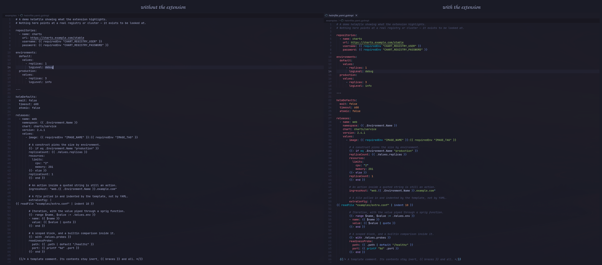

# Gotmpl YAML Highlighter

### Keep YAML. Add Go templates. Understand both.

[English documentation](../README.md) · [Документация на русском](../README.ru.md)

**JavaScript · VS Code API · TextMate grammars**

---

VS Code tooling for `*.yaml.gotmpl`: layered syntax highlighting, function documentation, completions and structural diagnostics.

The extension retains YAML tokenisation and adds Go-template scopes through an injection grammar. Grammar tests use the same TextMate engine as the editor and assert scopes by position.

**Deliberate scope:** no template execution, formatter or YAML-schema validation. Known parsing ambiguities are documented rather than hidden.

[Features, setup & limits (EN)](../README.md) · [Возможности, сборка и ограничения (RU)](../README.ru.md) · [Changelog](../CHANGELOG.md)

---

[Igor Kramar](https://github.com/IgorKramar) · Developer tooling
