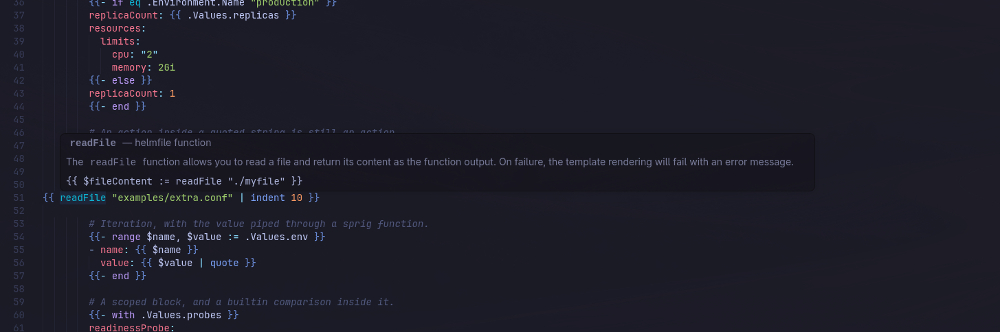
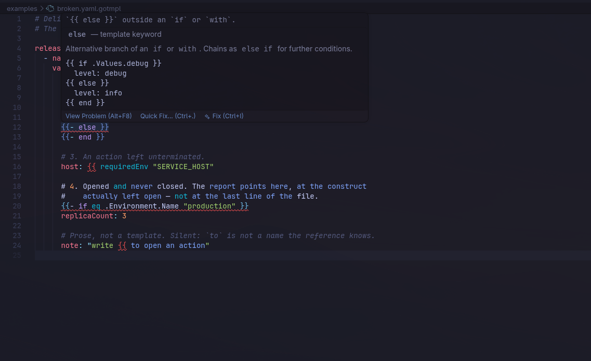

<div align="center">

# Gotmpl YAML Highlighter

[English](README.md) · **Русский**

**YAML остаётся YAML. Go-шаблоны получают свою подсветку.**

JavaScript · VS Code API · TextMate

</div>

---

Расширение VS Code для файлов `*.yaml.gotmpl`: подсветка синтаксиса, справка при наведении, автодополнение и структурная диагностика. Предназначено для шаблонов helmfile и похожих конфигураций.


## Задача

В `helmfile.yaml.gotmpl` одновременно присутствуют два языка: YAML снаружи и Go template внутри `{{ … }}`. Расширение включает YAML-грамматику и добавляет поверх неё injection-грамматику шаблонов, сохраняя различимость ключей, строк, списков, комментариев и шаблонных конструкций.

## Возможности

- **Подсветка:** разделители, управляющие конструкции, функции helmfile и Sprig, переменные, пути `.Values`, конвейеры, строки, числа и комментарии шаблонов. Поддерживаются шаблонные действия внутри строк и блочных скаляров.
- **Справка:** описание функции или ключевого слова с примером. Источники справочника — документация Sprig и helmfile; переопределённые функции отмечены отдельно.
- **Автодополнение:** функции и парные конструкции внутри `{{ … }}`. За пределами шаблонного действия расширение не вмешивается в дополнения YAML.
- **Диагностика:** незакрытые `{{`, пропущенные `end`, лишние `end` и `else` вне подходящей конструкции. В подходящих случаях доступно быстрое исправление.





## Инженерные решения

Цвета не зашиты в расширение: оно использует TextMate scopes, которые оформляет выбранная тема редактора. Тесты прогоняют грамматики через `vscode-textmate` и проверяют scopes по позициям, а не только внешний вид снимков экрана.

Справочник функций генерируется отдельно и хранится в репозитории. Сборка пакета не должна обращаться к сети для его восстановления.

## Разработка и сборка

```sh
npm install
npm run fetch-yaml-grammar
npm test
npm run lint
npm run typecheck
npx @vscode/vsce package
```

`fetch-yaml-grammar` получает встроенную YAML-грамматику VS Code для тестов. `npm test` также имеет предварительный шаг, который получает её при отсутствии. Для деталей смотрите [`package.json`](package.json).

## Границы и ограничения

Расширение работает только с `*.yaml.gotmpl`: другие расширения шаблонов не входят в его область ответственности. Оно не форматирует файлы и не исполняет шаблоны.

Эти файлы используют собственный идентификатор языка; `redhat.vscode-yaml` не обслуживает их как обычный YAML. Поддержка YAML Schema не заявлена: до исполнения шаблона валидный YAML-документ может ещё не существовать.

Внутри YAML-строк буквальный текст `{{` иногда неотличим от начала незавершённого шаблона. Известные неоднозначности и ограничения диагностики описаны в [English README](README.md#known-limits).

## Лицензия

[MIT](LICENSE).

---

[Игорь Крамарь](https://github.com/IgorKramar) · Инструменты разработчика
